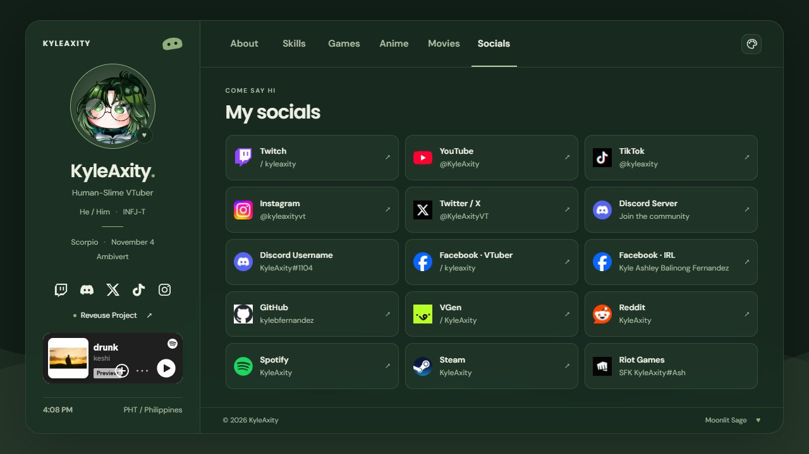

# KyleAxity — Personal Website

A little corner of the internet for Kyle: Human-Slime VTuber, multimedia creator, programmer, and community moderator from Reveuse Project.

<div align="center">
  

  [](https://kyleaxityprofile.vercel.app/)
  [](https://kyleaxityprofile.vercel.app/)
</div>

## About the website

This website brings together my creative work, community experience, favorite games, anime, movies, and social profiles. It uses a tabbed layout so visitors can explore each section without navigating through a long landing page.

Please call me **Kyle**, not Axity.

## Features

### Design and themes

- **Moonlit Sage** is the default: deep greens with soft sage accents.
- Four additional themes: **Sage & Cream**, **Comic Pop**, **Glitch**, and **Girly Pink**.
- Theme preferences are saved in the visitor's browser.
- Responsive layouts, translucent panels, animated background waves, and consistent typography.
- Keyboard navigation for the main tabs and support for reduced-motion preferences.

### About and experience

- Rotating typing introduction, starting with **Human-Slime VTuber**.
- Click-to-change avatar artwork, with no automatic image rotation.
- Profile details, nicknames, PC setup, and streaming FAQ.
- Experience, education, and training records.
- Highlighted moderation across **Twitch, TikTok, YouTube, and Discord**, plus Discord server creation and setup.
- A link to the list of creators and communities I moderate for.
- Live clock in Philippine time.

### Games, anime, and movies

- Game board with favorites, games in rotation, games I like, and games I want to play.
- MyAnimeList statistics, shelves, favorites, and recent updates.
- Cached MAL profile snapshot with an attempted refresh through the public Jikan API.
- Marvel movie and series rankings displayed as poster cards.
- DC favorites and additional movie collections.

### Socials and music

- One-page social directory with PNG platform logos.
- Separate Discord server invite and Discord username entry.
- Direct Spotify and Steam profile links.
- Official Spotify embed for **“drunk” by keshi**.
- A music toggle on smaller screens.

The Spotify player starts when a visitor presses Play. Playback availability, including whether a preview or full playback is offered, is controlled by Spotify. This site does not host the song's audio.

## Tech stack

| Part | Technology |
| --- | --- |
| Structure | HTML5 |
| Styling | Custom CSS, CSS variables, responsive media queries |
| Interaction | Vanilla JavaScript |
| Content | Local JSON files |
| Fonts | DM Sans and Poppins |
| Anime data | MyAnimeList snapshot and Jikan API |
| Music | Spotify Embed |
| Hosting | Vercel, connected to GitHub |

There is no frontend framework, package installation, or build step required.

## Run locally

Clone the repository:

```bash
git clone https://github.com/kylebfernandez/KyleAxity-Profile.git
cd KyleAxity-Profile
```

Serve the folder with a local HTTP server. If Python is installed:

```bash
python -m http.server 4173
```

Open [localhost:4173](http://localhost:4173). A local server is needed because the website loads its JSON data with `fetch`; opening `index.html` directly may prevent that data from loading.

## Project structure

```text
KyleAxity-Profile/
├── assets/                  # Avatar artwork, covers, PNG logos, and preview
├── index.html               # Page layout, static content, and Spotify embed
├── style.css                # Layout, themes, and animations
├── typography.css           # Shared text sizes and final layout refinements
├── script.js                # Navigation, themes, typing effect, avatar, and clock
├── stream-about.js          # Profile, PC setup, and FAQ content
├── games.json               # Game board lists
├── mal.js                   # Anime views, API refresh, and cache handling
├── mal-snapshot.json        # Saved public MyAnimeList profile data
├── movies.js                # Movie cards, filters, and pagination
├── movies.json              # Additional movie collections
├── marvel-tiers.json        # Marvel rankings
├── dc-favorites.json        # DC favorites
├── socials.js               # Social directory and mobile music toggle
├── socials.json             # Social accounts, URLs, and logo paths
└── README.md
```

## Customization

| Change | File |
| --- | --- |
| Introductory roles and avatar choices | `script.js` |
| Profile text, PC specifications, and FAQ | `stream-about.js` |
| Experience, education, and static page text | `index.html` |
| Theme colors and layout | `style.css` |
| Font sizes and responsive type scale | `typography.css` |
| Games and movie lists | The corresponding JSON files |
| Social links and account names | `socials.json` |
| Social logos | `assets/social-logos/` |
| Spotify track | The embed URL in `index.html` |

Keep asset paths relative so the files remain portable between hosts.

## Deployment

The production website is hosted on [Vercel](https://kyleaxityprofile.vercel.app/) and connected to this repository's `main` branch. Pushing an update to `main` triggers a Vercel deployment.

When updating through GitHub's file uploader, upload the extracted website files into the folder containing `index.html`. Include the updated CSS, JavaScript, JSON, and asset files—not the ZIP archive. Check the Vercel project's **Deployments** page for the deployment result.

## Anime data notes

The bundled MAL snapshot was collected on **November 13, 2026**. The website attempts to refresh supported public profile data through [Jikan](https://docs.api.jikan.moe/) and caches successful responses in the visitor's browser. If the API is unavailable, the saved snapshot remains visible. Curated profile shelves may continue to use snapshot data.

## Credits and artwork

- Personal portfolio reference: [H1tRecord's Portfolio Website](https://github.com/H1tRecord/Portfolio-Website).
- Anime profile: [KyleAxity_ on MyAnimeList](https://myanimelist.net/profile/KyleAxity_).
- Music player: [Spotify Embed](https://developer.spotify.com/documentation/embeds).
- Platform logo PNGs use cached site favicons retrieved through Google's favicon service.

Character illustrations, game covers, anime artwork, movie posters, music, and platform trademarks belong to their respective owners. Their inclusion here does not grant permission to reuse them. No open-source license has been added to this repository.

## Find me

- [Twitch](https://www.twitch.tv/kyleaxity)
- [Discord community](https://discord.gg/g5N9KKaq53)
- Discord username: **KyleAxity#1104**
- [YouTube](https://www.youtube.com/@KyleAxity)
- [Instagram](https://www.instagram.com/kyleaxityvt/)
- [X](https://x.com/KyleAxityVT)
- [GitHub](https://github.com/kylebfernandez)

More links are available in the website's **Socials** section.
